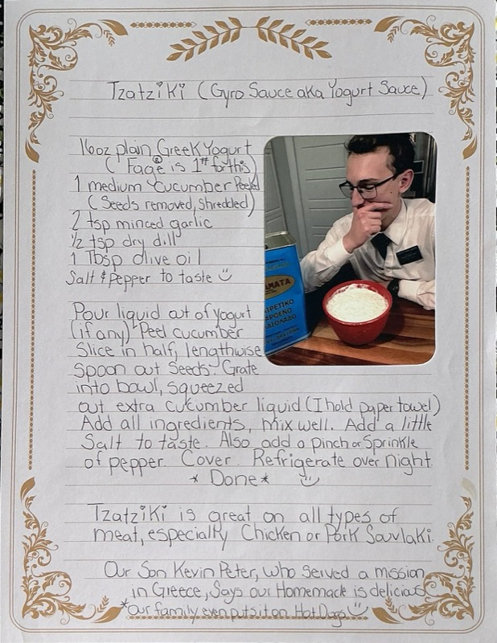
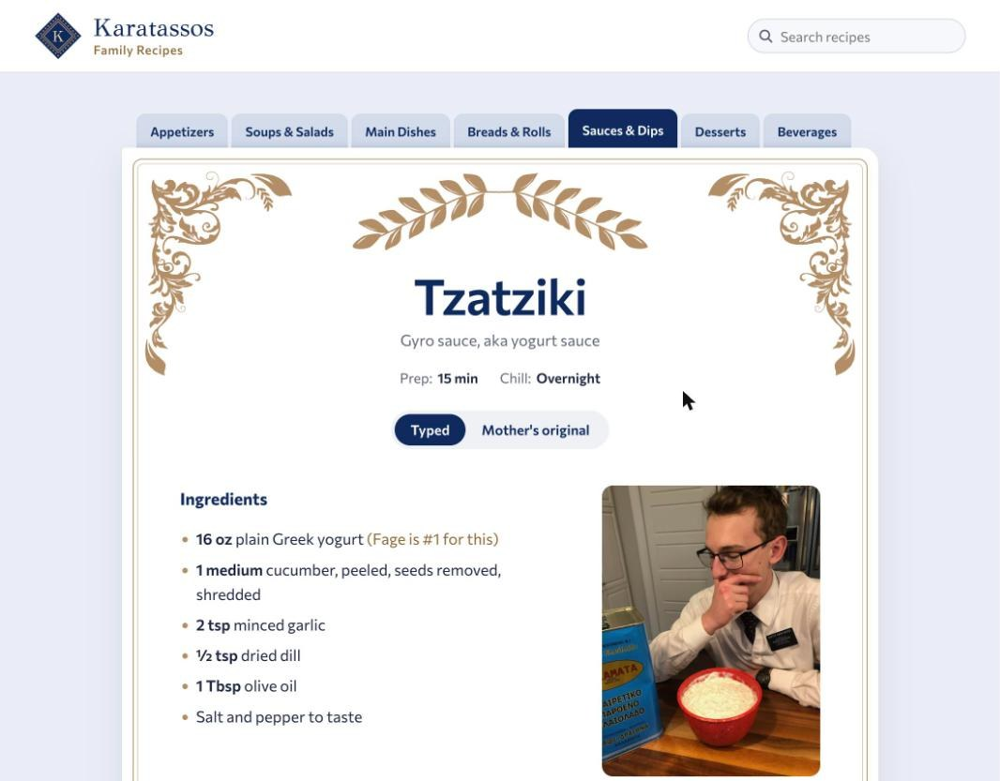
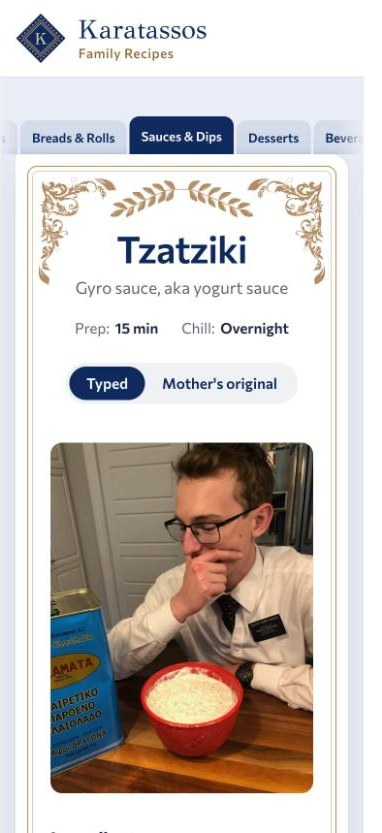
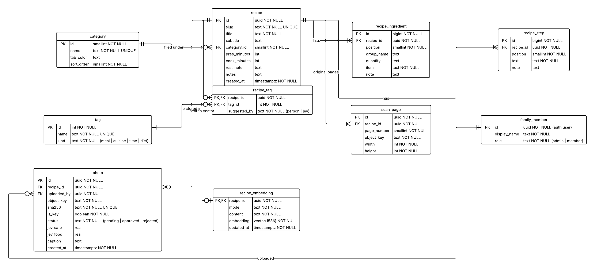
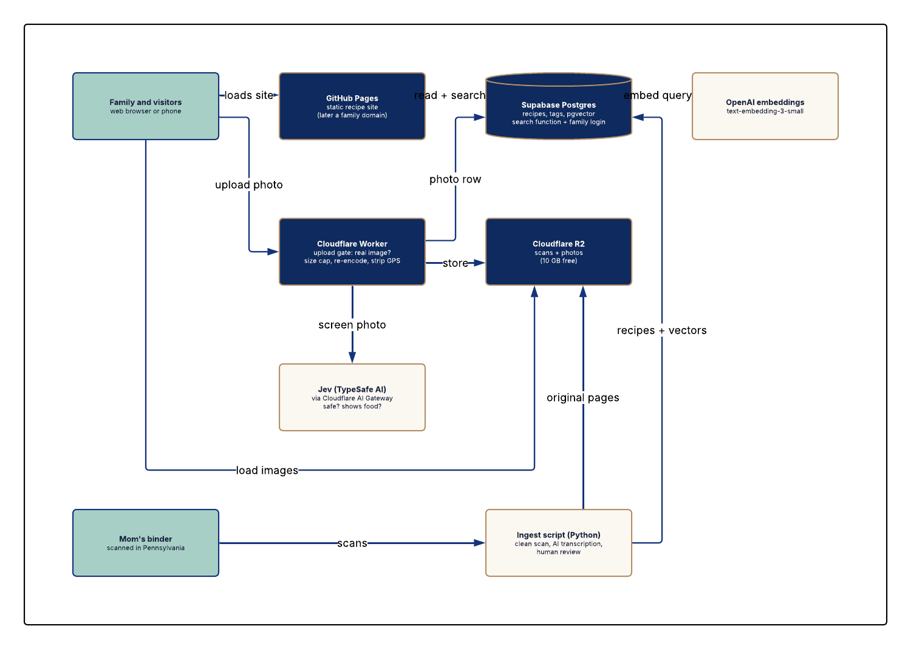
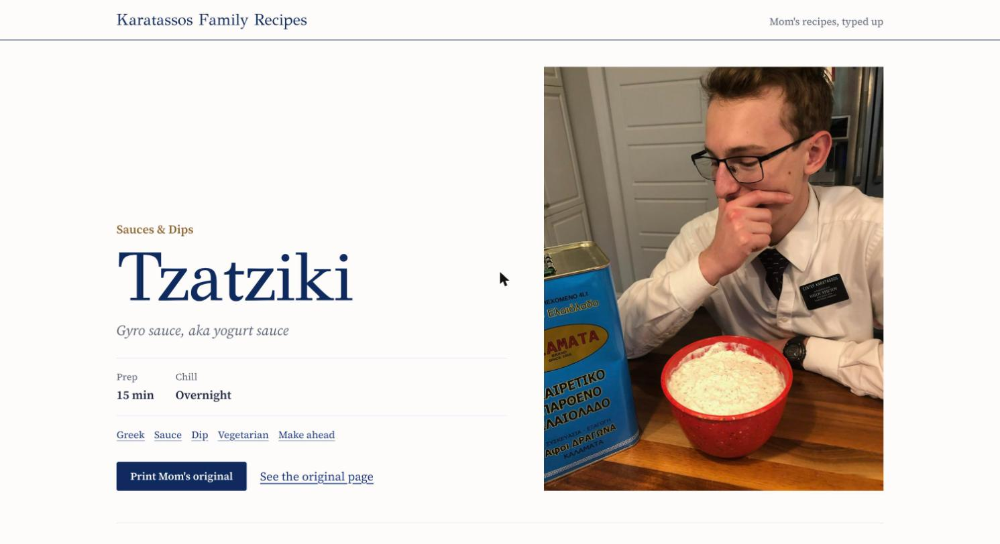
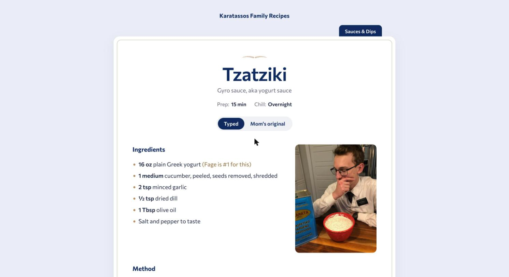
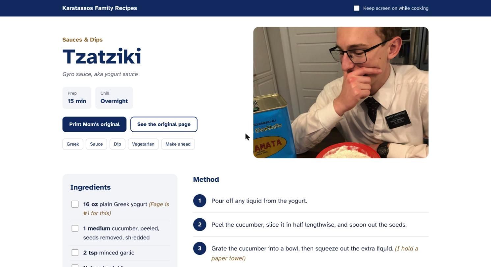

# Initial design: Karatassos Family Recipes

A website for my mother's handwritten recipe binder. Each recipe gets a typed page that's easy to read and search, and you can still see or print her original handwritten page.

| Mother's page | Typed recipe card | On a phone |
|---|---|---|
|  |  |  |

Live: **https://nexkiv.github.io/family-recipes/** · Design prototypes: https://nexkiv.github.io/family-recipes/prototypes/

## Goals

- Scan every page in Mother's binder (in Pennsylvania, Thanksgiving week) and type each one up.
- Lay out each recipe page like the binder page: title on top, key photo top right, ingredients, then method.
- Print the original handwritten page with one button.
- Let family add photos of what they made. Every upload is checked before it's shown.
- Tags (dinner, Greek, snack, quick…) and binder sections (Main Dishes, Sauces & Dips…).
- Semantic search across all recipes ("something with yogurt for a party"), with RAG answers that link to the recipes.

## ERD

| Decision | Why |
|---|---|
| Ingredients and steps are rows, not one text blob | Lets search match ingredients, keeps order, and fits mixed sections like "Cinnamon Coating". |
| `scan_page` is its own table | Some pages say "continue on back", so one recipe can have several original pages. |
| `recipe_tag` many-to-many, with `suggested_by` | Jev can suggest tags; a person confirms them. |
| `photo.status` + Jev scores | Uploads wait in `pending` until they pass the checks or Mother approves them. |
| `photo.is_key` instead of `recipe.key_photo_id` | Avoids a recipe↔photo foreign-key cycle (partial unique index: one key photo per recipe). |
| `recipe_embedding` one row per recipe | Recipes are short, so one vector each is enough; `model` makes re-embedding safe. |

## System design

| Piece | Choice | Why / alternative | Cost |
|---|---|---|---|
| Site | GitHub Pages (static) | Free and simple; moves to a family domain later | $0 |
| Database + search | Supabase Postgres + pgvector, Auth | Relational data + vectors in one place; used it for the Conference RAG project | Free tier |
| Images | Cloudflare R2 | 10 GB free, no download fees. Oracle Cloud (Prof. Reynolds' other suggestion) gives 20 GB but harder setup | $0 |
| Upload gate | Cloudflare Worker | Runs next to R2; does the checks before anything is stored | Free tier |
| Upload screening | Jev (TypeSafe AI) via Cloudflare AI Gateway | Returns "is this safe / is this food" with a confidence | ~$0.04 per M tokens |
| Embeddings | OpenAI `text-embedding-3-small` | Cheap, 1536-dim, already have a key | Pennies |

**Security boundaries**
- Reading recipes is public. Writing needs a family login (Supabase Auth). Row Level Security enforces this in the database.
- Uploads go through the Worker only:
  - check the real file type by its first bytes, not its name
  - cap the size at 15 MB
  - re-encode the image, which drops hidden payloads and GPS location
  - screen it with Jev
- Low-confidence uploads wait for Mother to approve them. The browser does the same type and size checks, but only for quick feedback; the Worker's checks are the ones that count.
- Keys live only in Worker and Supabase secrets, never in the static site.

**Scaling:** a family site gets little traffic. The static pages and R2 sit behind Cloudflare's and GitHub's CDNs, and the database only serves search and writes.

## Design

I tried three directions on the same recipe data, then chose **B, the recipe card**, and refined it:

| A. Editorial | B. Recipe card (chosen) | C. Kitchen mode |
|---|---|---|
|  |  |  |
| Magazine-style, Greek Font Society serif | Mother's page simplified; switch between typed and original | Tick off ingredients, keep the screen awake |

| Detail | Choice |
|---|---|
| Colors | Deep Greek blue #0E2A5E and a gold measured from Mother's printed pages (#B48E67). Every text color pair passes WCAG AA. |
| Logo | A navy diamond seal with a Greek Κ, based on the seal of the first Karatassos ancestor. |
| Ornaments | Gold acanthus corners and a laurel garland, drawn from the stationery her recipes are written on (taller corners on top, shorter ones on the bottom). |
| Sections | Blue binder tabs above the card (Appetizers … Beverages), like the binder's dividers. |
| Typed vs. original | One switch flips the card between the typed recipe and her scan; "Print Mother's original" prints only the scan. |
| Her voice | Her asides stay in her words but in the site's font, never a fake handwriting font. Her notes sit under "Mother's Notes". |

## Daily goals

| Date | Goal |
|---|---|
| Fri 11/20 | Create the Supabase project and schema from the ERD, then load tzatziki. |
| Sat 11/21 | Recipe card reads from Supabase. Home page with binder-section tabs and tag filters. |
| Mon 11/23 | R2 bucket + Worker upload gate (type, size, re-encode, strip GPS). |
| Tue 11/24 | Family login; Worker checks the login token. Jev screening + pending-photo approval. |
| Wed 11/25 – Sun 11/29 | In Pennsylvania: scan the binder. Ingest script: clean scans, AI draft transcription, I review each one. |
| Mon 11/30 | Load all recipes; generate embeddings. |
| Tue 12/1 | Hybrid search (full-text + vector) and search page. |
| Wed 12/2 – Thu 12/3 | RAG "ask the cookbook" with links to recipes. Jev tag suggestions. |
| Fri 12/4 | Print, mobile and accessibility polish. |
| Mon 12/7 | Security pass: RLS policies, rate limits, OWASP review. |
| Tue 12/8 | Demo video + class channel post. |
| Wed 12/9 – Thu 12/10 | Final report and submit (due Thu 12/10). |
